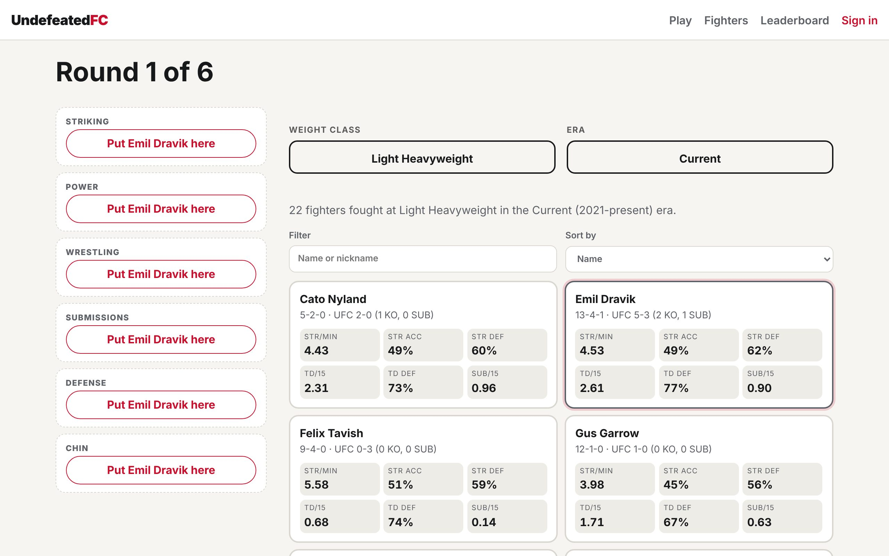
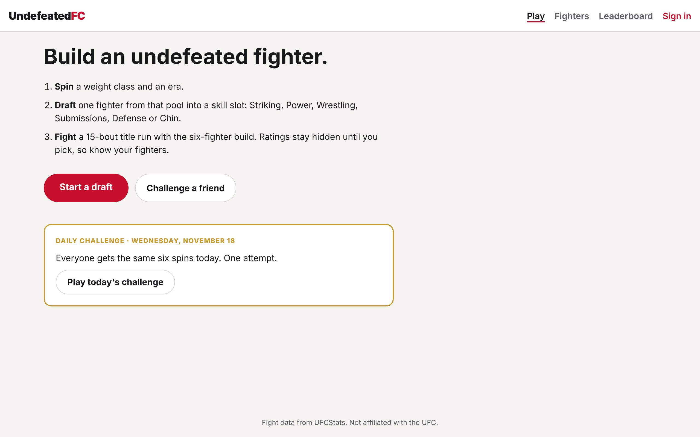
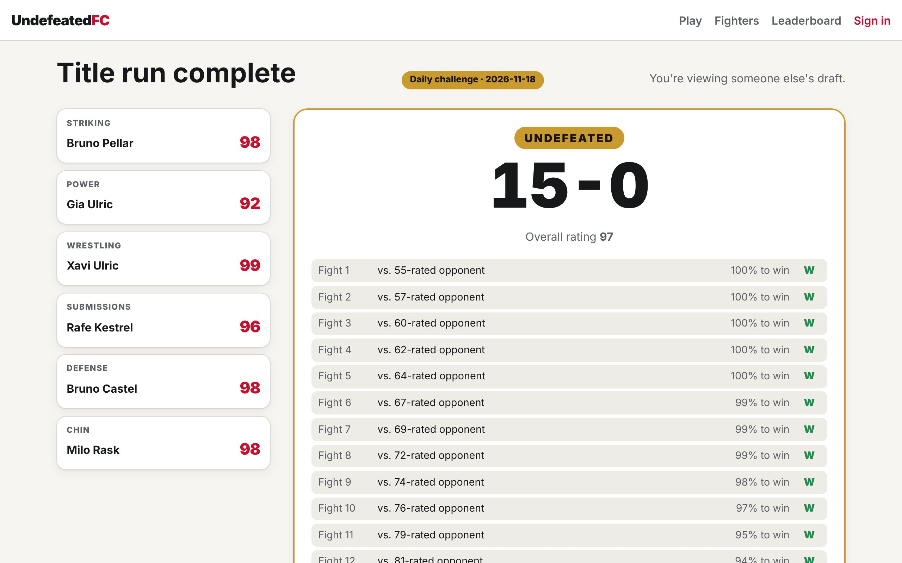
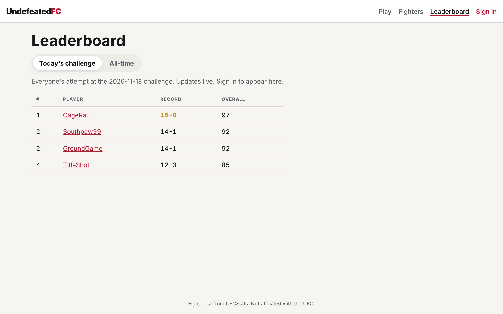
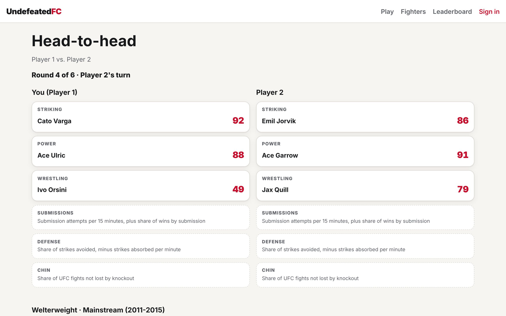
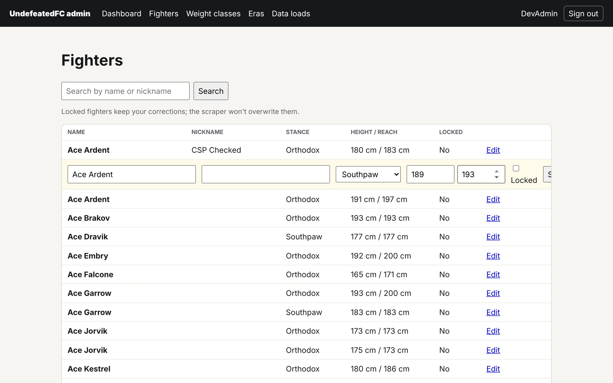
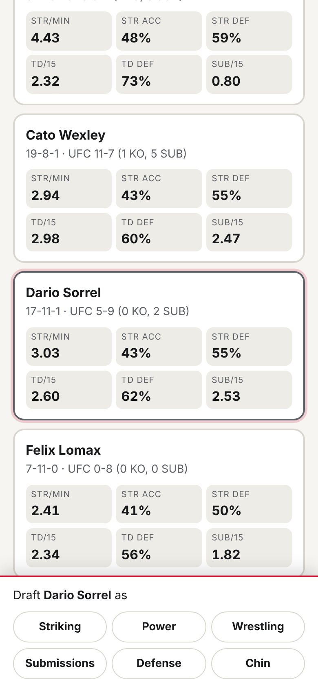
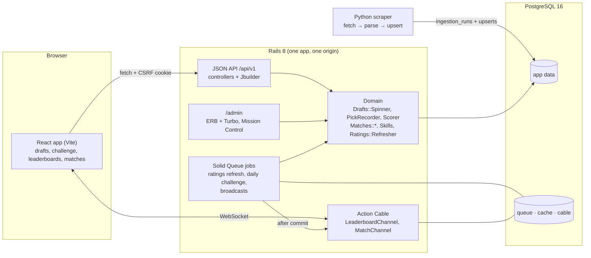

# UndefeatedFC

A UFC fighter-draft game. Each round you spin a weight class and an era, draft one
fighter from that pool into a skill slot (Striking, Power, Wrestling, Submissions,
Defense, Chin), and after six rounds your build fights a simulated 15-fight title run.
The goal is to go 15-0. Ratings stay hidden until you pick, so knowing the fighters is
the skill.



## Features

- **Solo drafts:** server-side seeded spins, a filterable pool, a slot board that
  reveals each rating as you pick, and a fight-by-fight title run with a share link.
- **Daily Challenge:** everyone gets the same six spins each day, one attempt per player.
- **Live leaderboards:** daily and all-time, cached, updating over Action Cable.
- **Head-to-head:** invite a friend by link, take turns in a snake draft from shared
  pools, then your builds fight.
- **Accounts:** optional; guest drafts move to your account when you sign in.
- **Admin console:** fix scraped data inline, manage divisions and eras, review data
  loads, recalculate ratings, watch jobs.
- **Data pipeline:** a Python scraper loads UFCStats into Postgres; ratings
  recompute automatically after each load.

| | |
|---|---|
|  |  |
|  |  |
|  |  |

Screenshots use the invented development dataset (`bin/rails db:seed`), not real fighters.

## Architecture



- **Rails owns the schema and the rules.** Game rules live in small service objects
  and are backed by database constraints (partial unique indexes, CHECK, a GiST
  exclusion constraint), so races can't corrupt a draft or a match.
- **One database, no Redis.** Jobs, cache and WebSockets use Solid Queue, Solid
  Cache and Solid Cable on Postgres.
- **The scraper and Rails share only the database.** The scraper upserts fight data
  and records each run; a scheduled job notices and recomputes ratings.

Every major choice has a short decision record in [docs/adr](docs/adr):

| ADR | Decision |
|---|---|
| [0001](docs/adr/0001-use-ruby-on-rails.md) | Ruby on Rails for the web app and API |
| [0002](docs/adr/0002-use-postgresql.md) | PostgreSQL |
| [0003](docs/adr/0003-monorepo-layout.md) | One repository with Rails at the root |
| [0004](docs/adr/0004-python-scraper.md) | A Python scraper that writes to the Rails schema |
| [0005](docs/adr/0005-precomputed-percentile-ratings.md) | Precomputed percentile ratings |
| [0006](docs/adr/0006-service-objects-for-game-rules.md) | Service objects for rules that span models |
| [0007](docs/adr/0007-seeded-server-side-randomness.md) | Seeded randomness decided on the server |
| [0008](docs/adr/0008-hide-ratings-until-picked.md) | Hide ratings until a fighter is picked |
| [0009](docs/adr/0009-react-spa-served-by-rails.md) | A React app served by Rails from the same origin |
| [0010](docs/adr/0010-cookie-sessions-over-jwt.md) | Cookie sessions over JWT |
| [0011](docs/adr/0011-solid-trifecta-instead-of-redis.md) | Solid Queue, Cache and Cable instead of Redis |
| [0012](docs/adr/0012-hotwire-for-internal-tools.md) | Hotwire for internal tools |

## Getting started

### Prerequisites

- Ruby 3.3.6 (see `.ruby-version`)
- Node 22 (for the React app in `web/`)
- PostgreSQL 16, either installed locally or through Docker
- Python 3.12+ (only for the scraper)

### Database

Use a local Postgres through its Unix socket, or start the bundled container:

```bash
docker compose up -d
export DB_HOST=localhost DB_USER=postgres DB_PASSWORD=postgres
```

### Setup and run

```bash
bin/setup --skip-server
bin/rails server
cd web && npm install && npm run dev   # open http://localhost:5173
```

Vite proxies `/api` and `/cable` to Rails, so the browser sees a single origin, as it
does in production, where Rails serves the built app (`cd web && npm run build`,
then http://localhost:3000).

In development, `bin/rails db:seed` creates invented fighters and bouts so the game
is playable before the scraper has run. To load real data instead, start from an
empty fighters table and follow [scraper/README.md](scraper/README.md). See
[docs/data-model.md](docs/data-model.md) for the schema.

### Admin

`/admin` is for staff: fix fighter details inline (corrections are locked against
re-scrapes), choose which divisions can be spun, adjust eras, review scraper runs,
recalculate ratings, and (in production) watch jobs in Mission Control.

```bash
bin/rails admin:grant[you@example.com]
```

## API

Everything the React app does goes through a JSON API under `/api/v1` (drafts, spins,
picks, fighters, accounts, daily challenge, leaderboards, matches) plus two Action
Cable channels. See [docs/api.md](docs/api.md).

## Tests and checks

```bash
bin/rails test          # models, services, jobs, channels, API and admin requests
bin/rails test:system   # a full draft in headless Chrome (build web/ first)
bin/rubocop             # style
bin/brakeman            # security static analysis
cd web && npm test      # React components, hooks and the draft reducer
cd scraper && pytest    # parsers, loader and CLI (see scraper/README.md for the DB)
```

CI runs all of these on every pull request, plus a production Docker image build
(`.github/workflows/ci.yml`).

## Deploying

`config/deploy.yml` deploys with Kamal 2 to any Linux server with Docker: Puma with
Solid Queue inside it, a Postgres 16 accessory, and TLS from kamal-proxy.

```bash
export KAMAL_SERVER=203.0.113.10 APP_HOST=undefeatedfc.example.com
export KAMAL_REGISTRY_USERNAME=you KAMAL_REGISTRY_PASSWORD=... POSTGRES_PASSWORD=...
bin/kamal setup
```

## Repository layout

```
app/, config/, db/, test/   Rails application (API, channels, jobs, admin)
web/                        React app for players (see web/README.md)
scraper/                    Python package that loads UFCStats data (see scraper/README.md)
docs/                       roadmap, data model, API reference, ADRs, screenshots
```
