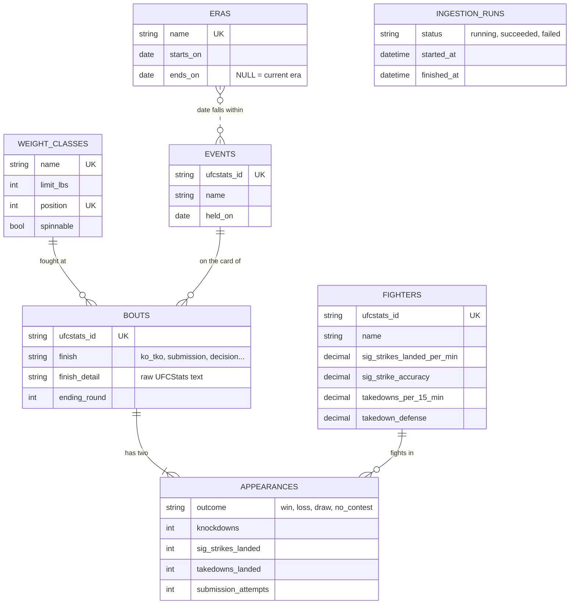

# Data model

## Why it is shaped this way

- **Eras link to events by date, not by foreign key.** An era is a date range, so
  "bouts in the Modern era" is `events.held_on BETWEEN starts_on AND ends_on`.
  A GiST exclusion constraint stops eras from overlapping, so every date maps to
  exactly one era.
- **Appearances instead of red/blue columns on bouts.** "Fighters who fought at
  Lightweight in 2016-2020" is one join through appearances, and per-fight stats
  have a natural home.
- **Weight classes and eras are tables, not enums.** Bouts get real foreign keys,
  and admins can change which divisions are spinnable without a deploy.
- **Rules are enforced twice.** Model validations give readable errors; CHECK,
  UNIQUE and exclusion constraints hold even if something writes around Rails
  (such as the Python scraper).
- **`ufcstats_id` is unique on every scraped table.** It is the key the scraper
  upserts on, so loading the same page twice updates rows instead of duplicating
  them.
